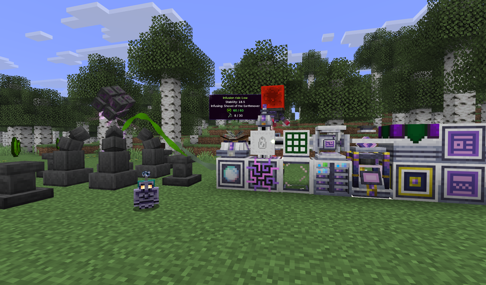
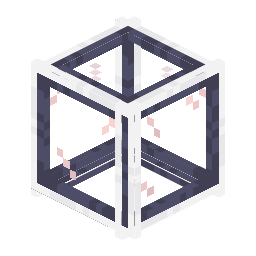
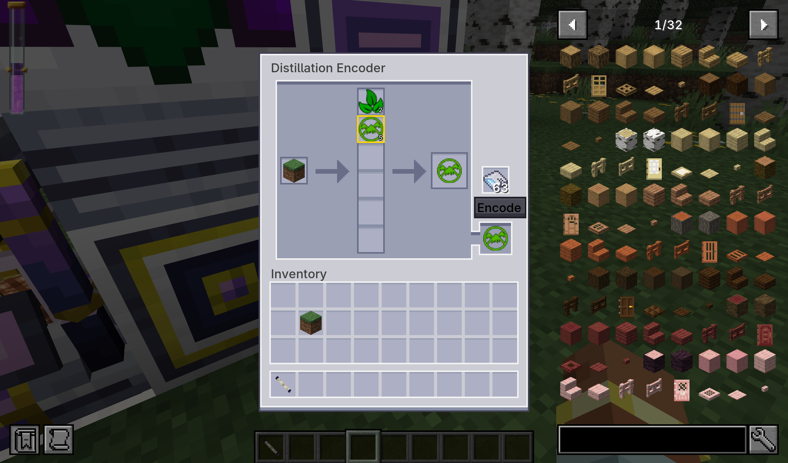
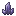
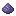
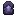
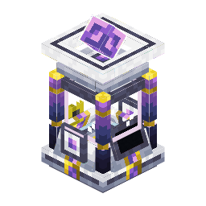

# Thaumic Energistics: CE

*In-game showcase from an earlier version; some models have since been updated.*

**Bring Thaumaturge's essentia and arcane crafting into your ME network.**

Thaumic Energistics: CE connects **Thaumaturge** and **Applied Energistics 2** on modern Minecraft. Store essentia, supply alchemy and infusion from your network, automate arcane recipes, and access your resources through wireless terminals.

Based on the original Thaumic Energistics, CE expands the experience with crystal cultivation, a material and research progression, thaumic tools and more ways to use your ME network.

## Features

### Essentia in your ME network

Store aspects in **ME Essentia Storage Cells from 1k to 256k**. Browse your stock through an Essentia Terminal, search by localized aspect names, and use containers to deposit or withdraw essentia. **Essentia Access Cards** let standard ME Import, Export and Storage Buses work with external essentia containers.

### Arcane crafting and automation

Craft from your network with the **Arcane Crafting Terminal**, complete with wand and crystal slots and crafting-cost information. Use the **Knowledge Inscriber** to record researched recipes in Knowledge Cores, then let the **Arcane Assembly Chamber** handle automated crafting. **Vis Relay Interfaces** connect your equipment to Thaumaturge's magic supply.

### Alchemy and infusion

Supply essentia with **Alchemy Providers**, **Alchemy Wireless Receivers** and **Infusion Providers**. Monitor infusion requirements and stability with the **Occult Monitor**, or use the **Distillation Encoder** to record aspect yields in processing patterns.

*An earlier-version screenshot showing aspect yields encoded into a processing pattern.*

### Wireless terminals and golems

Carry your network with the **Wireless Essentia Terminal** and **Wireless Arcane Crafting Terminal**. The wireless arcane terminal stores its own ingredients, crystals, wand and upgrades, without needing a placed arcane terminal. Equip a **Golem Wireless Backpack** to let a golem exchange items with your network, and customize its appearance with supported materials.

### Crystal cultivation and research

Grow **Thaumic Crystals** and process them into circuit boards, processors and equipment. Follow the research in your Thaumonomicon to unlock storage, terminals and automation. Use your harvest to develop your network, or turn it into Thaumic Crystal tools.

### Thaumic Crystal tools

Equip a **Thaumic Crystal sword, pickaxe, axe, shovel, hoe, wrench or cutting knife**. Upgrade the five ordinary Fluix tools through smithing, or craft the wrench and knife directly. Repair the tools with Vis on a recharge pedestal.

### More to discover

Burn essentia for AE power in the **Essentia Vibration Chamber**, control devices with an **Essentia Level Emitter**, or try your luck earning research points with the **Box of Probability** and its **Fluix Brain** upgrade.

## Integrations

- **JEI:** recipe viewing and transfer.
- **Jade:** machine status and crafting information.
- **MEGA Cells (Minecraft 1.21.1 only):** additional high-capacity essentia storage cells.
- **Curios:** wearable wireless terminals.
- **AE2 Wireless Terminal Library:** quantum bridge connections for wireless terminals.
- **Pattern providers:** essentia support for AE2 and supported versions of ExtendedAE, ExtendedAE Plus, AdvancedAE and AE2 Lightning Tech Reborn.

Server settings let you adjust essentia visibility, integrations and machine values. Addon compatibility varies by Minecraft and addon version; Lightning Tech Reborn support targets its 26.1.2 development branch.

## Requirements

**Required:** Applied Energistics 2, Thaumaturge and NeoForge.

Available for **Minecraft 1.21.1 and 26.1.2**. Features described here follow the **26.1.2 / 2.7.5.2** version; other versions may differ.

For the current 26.1.2 build, use **Java 25**, **NeoForge 26.1.2.97+**, **AE2 26.1.13-beta** and **Thaumaturge 1.1.0 built from source revision `c71c2a27`**. Older Thaumaturge 1.0.3 builds are incompatible. Thaumaturge is not included; check the selected file's dependency requirements before installing.

[Source](https://github.com/BeiWuCN/Thaumic-Energistics-CE) · [Release notes](https://github.com/BeiWuCN/Thaumic-Energistics-CE/releases) · [Report bugs](https://github.com/BeiWuCN/Thaumic-Energistics-CE/issues)

## Credits

Developed and maintained by **BeiWuCN**, based on the original **Thaumic Energistics**, with historical author notices preserved. Thanks to the **Thaumaturge** and **AE2** teams.

Code: **MIT**. Textures by **麦淇淋**: **CC BY-NC-SA 3.0**. See [asset credits and licenses](https://github.com/BeiWuCN/Thaumic-Energistics-CE/blob/26.1.2/LICENSE-ASSETS.md) for model and third-party attribution.
